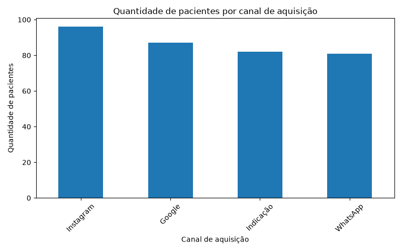

# Análise de Dados — Clínica de Estética

## Sobre o projeto

Este projeto tem como objetivo analisar dados fictícios de uma clínica de estética, utilizando ferramentas de análise de dados para identificar oportunidades de melhoria nos resultados financeiros e nas estratégias de marketing.

O estudo simula um cenário de negócio e busca transformar dados em informações úteis para a tomada de decisões.

## Objetivos da análise

- Analisar o faturamento por procedimento.
- Identificar os procedimentos com maior lucro estimado.
- Avaliar os canais de aquisição de pacientes.
- Criar visualizações para facilitar a interpretação dos resultados.
- Identificar oportunidades de melhoria para o negócio.

## Ferramentas utilizadas

- Python
- Pandas
- Matplotlib
- SQL (próxima etapa)
- Power BI (próxima etapa)

## Base de dados

A base utilizada contém 500 registros fictícios de agendamentos realizados durante o ano de 2025.

As informações incluem:

- Data do agendamento
- Procedimento realizado
- Profissional responsável
- Status do agendamento
- Valor cobrado
- Custo variável estimado
- Canal de aquisição
- Forma de pagamento

**Importante:** todos os dados são sintéticos e foram criados exclusivamente para fins educacionais e de portfólio.

## Análises realizadas

### 1. Faturamento por procedimento

Agrupamento dos valores cobrados por procedimento, permitindo identificar quais serviços apresentam maior faturamento.

### 2. Lucro estimado

Cálculo da diferença entre o valor cobrado e o custo variável estimado.

### 3. Canais de aquisição

Análise da quantidade de pacientes distintos associados a cada canal de aquisição.

### 4. Visualização de dados

Criação de gráfico de barras utilizando Matplotlib para facilitar a comparação entre os canais.

## Principais resultados

- O Bioestimulador apresentou o maior faturamento e o maior lucro estimado na base analisada.
- O Instagram apresentou a maior quantidade de pacientes distintos associados ao canal.
- Os resultados permitem explorar oportunidades relacionadas à estratégia comercial e ao marketing da clínica.

## Próximas etapas

- Desenvolver consultas utilizando SQL.
- Criar um dashboard interativo no Power BI.
- Ampliar as análises de desempenho financeiro e operacional.
- Elaborar recomendações estratégicas para o negócio.

## Autora

Projeto desenvolvido por Amanda de Souza Santos.

Em desenvolvimento como parte da minha jornada de aprendizado em Análise de Dados.

## Visualização dos resultados

### Pacientes por canal de aquisição

## Principais resultados

- **Procedimento com maior faturamento:** Bioestimulador.
- **Procedimento com maior lucro estimado:** Bioestimulador, com R$ 52.250.
- **Canal com maior número de pacientes distintos associados:** Instagram, com 96 pacientes.

## Conclusão

A análise mostrou que o bioestimulador apresentou o melhor resultado financeiro entre os procedimentos analisados. O Instagram foi o canal associado ao maior número de pacientes distintos na base.

Esses resultados podem ajudar na tomada de decisões sobre estratégias comerciais, divulgação e planejamento financeiro da clínica.
